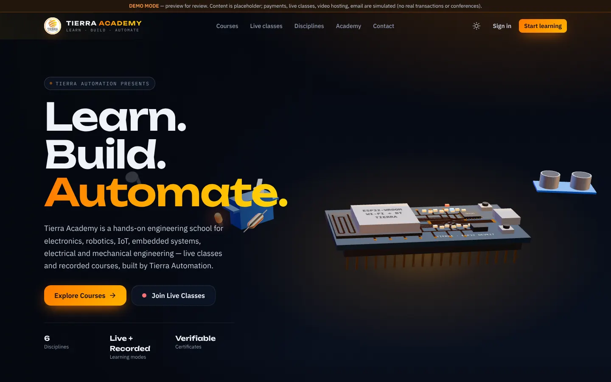
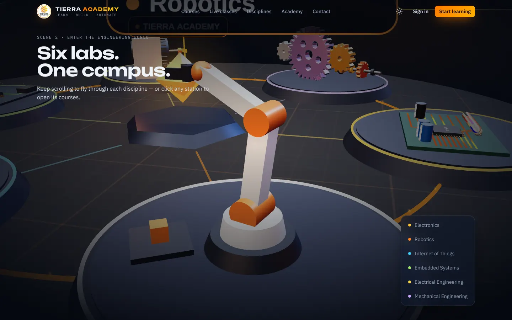
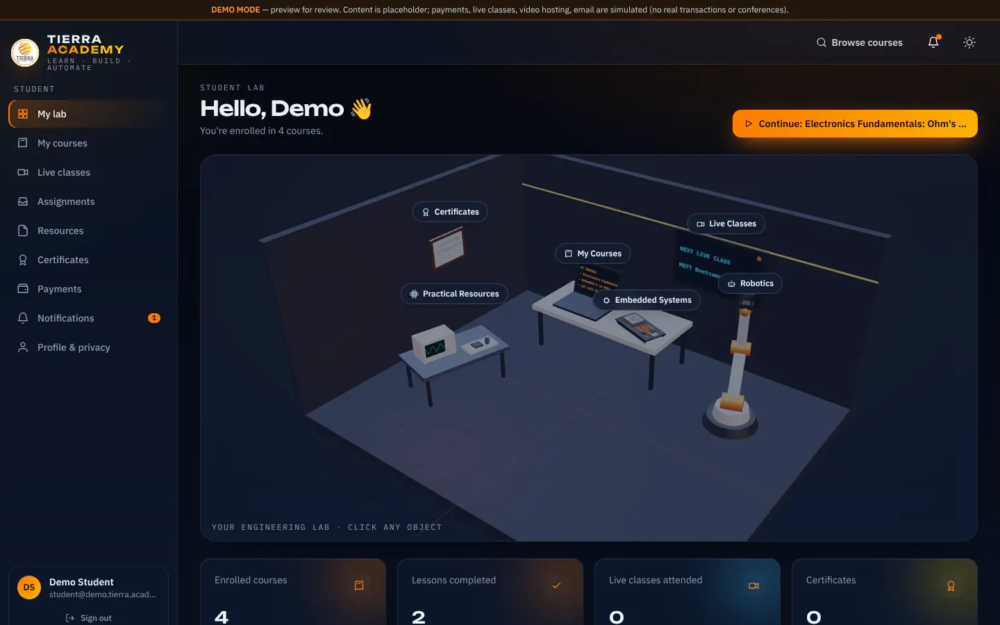
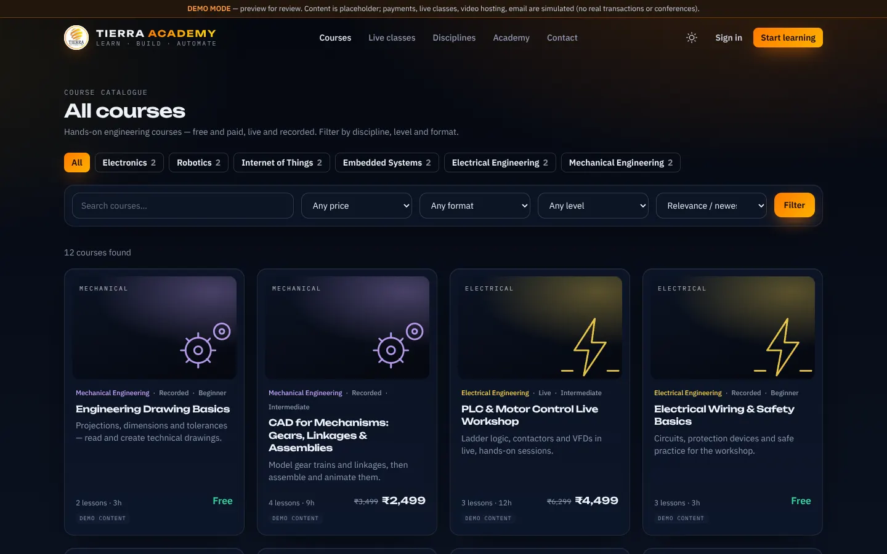
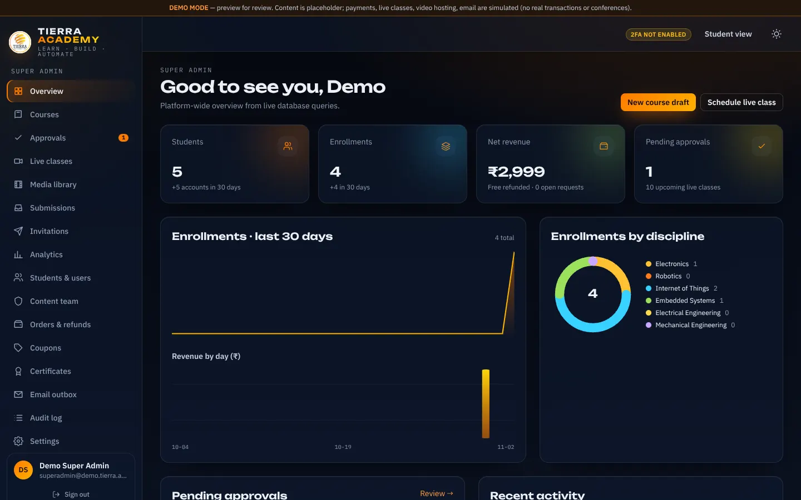
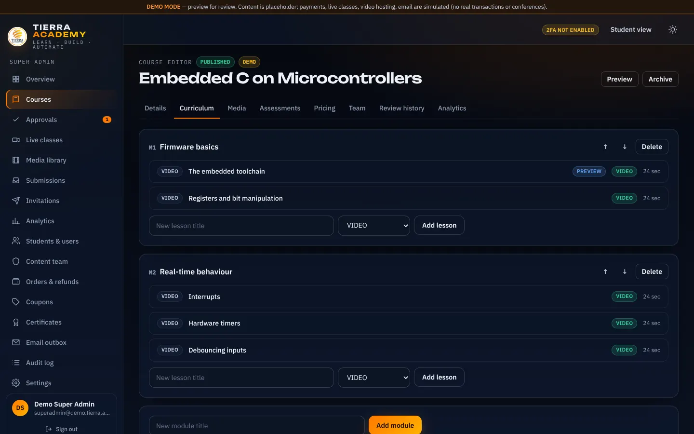

# TIERRA ACADEMY

**Learn. Build. Automate.** — the engineering learning platform of [Tierra Automation](https://tierraautomation.in/).

A complete LMS with a cinematic 3D public website and two role-separated panels:

- **Public site**: an interactive Three.js hero (an ESP32 board that assembles itself), a scroll-driven "engineering campus" with six discipline stations, a course catalogue with search and filters, course pages, live schedule, instructors, FAQ, contact, policies and public certificate verification.
- **Student panel**: an interactive 3D "engineering lab" dashboard, a secure lesson player (resume, speed, captions, completion), live classroom, quizzes, assignments, resources, certificates, payments, notifications, profile and privacy controls.
- **Admin panel**: shared by two roles.
  - **Super Admin**: full control.
  - **Content Manager**: drafts, media, quizzes, proposing and hosting live classes, and limited analytics. Cannot publish, price, view revenue, refund, change settings or manage users.

> **Status: demonstration build for CEO review.** Payments, live classes, video hosting and email run in clearly labelled **demo/development modes** until production credentials are configured. See [`PROJECT_STATUS.md`](PROJECT_STATUS.md).

## Preview

| Home (3D hero) | Engineering world | Student lab |
|---|---|---|
|  |  |  |
| **Catalogue** | **Admin overview** | **Course editor** |
|  |  |  |

## Stack

| Layer | Technology |
|---|---|
| App | Next.js 15 (App Router, Server Components, Server Actions), React 19, TypeScript |
| Styling | Tailwind CSS v4, CSS design tokens for dark and light (gradient-white) themes |
| 3D & motion | Three.js (procedural models, no external assets), GSAP + ScrollTrigger, CSS animations |
| Data | PostgreSQL via `postgres` (Supabase-compatible), **Row Level Security on every table** |
| Auth | Local (scrypt) **or** Supabase Auth; HS256 session cookie; TOTP MFA |
| Live | Zoom Meeting SDK + Server-to-Server OAuth, **or** demo classroom |
| Video | Cloudflare Stream (signed playback), **or** local dev storage |
| Payments | Razorpay (orders, signature + webhook verification, refunds), **or** demo simulator |
| Email | Resend, **or** dev outbox (`/admin/outbox`) |
| Tests | Vitest (unit + DB policy/workflow), Playwright (E2E), k6 + Node load scripts |

## Quick start (local)

```bash
# 1. Requirements: Node 20.11+, PostgreSQL 15+ (or `supabase start`), ffmpeg (optional, for demo clips)
npm install
cp .env.example .env.local            # defaults run fully in demo mode

# 2. Database (local Postgres; the role needs CREATEROLE for the local auth shim)
createdb tierra_academy
npm run db:migrate
DEMO_USER_PASSWORD='<choose-a-strong-password>' npm run db:seed   # demo content + demo accounts
npm run media:samples                   # optional: regenerates synthetic demo video clips

# 3. Run
npm run dev                             # http://localhost:3000
```

Demo accounts (seeded only when `APP_MODE` is not `production`). Each uses `DEMO_USER_PASSWORD`, or a random password written to `.demo-credentials.local`.

| Role | Email |
|---|---|
| Super Admin | superadmin@demo.tierra.academy |
| Content Manager (assigned: Electronics, IoT, Embedded) | cm@demo.tierra.academy |
| Content Manager (unassigned) | cm2@demo.tierra.academy |
| Student (with enrollments) | student@demo.tierra.academy |
| Student | student2@demo.tierra.academy |

Demo coupons: `WELCOME10`, `TIERRA500`, `DEMOFREE100`.

### Real Super Admin (never via public sign-up)

Set `SUPER_ADMIN_SETUP_TOKEN` (24+ random chars), open `/setup` once, then remove the token. Or run:

```bash
SUPER_ADMIN_PASSWORD='…' npm run provision:super-admin -- --email you@tierraautomation.in --name "Full Name"
```

Both paths refuse to run once any Super Admin exists.

## Scripts

| Command | Purpose |
|---|---|
| `npm run dev / build / start` | Next.js dev server / production build / serve |
| `npm run build:academy` | Build for `tierraautomation.in/academy` (basePath `/academy`) |
| `npm run typecheck`, `npm run lint` | TypeScript / ESLint |
| `npm run test:unit` | Pure logic: JWT, TOTP, crypto, RBAC, pricing, eligibility, uploads, signatures |
| `npm run test:db` | RLS policies + payment/refund/invitation/certificate/publishing workflows against Postgres (`DATABASE_URL_TEST`, reset on each run) |
| `npm run test:e2e` | Playwright (desktop + mobile) |
| `npm run load:local` / `load:smoke` | Node load generator / k6 scenarios ([docs/LOAD_TESTING.md](docs/LOAD_TESTING.md)) |
| `npm run db:migrate`, `db:seed`, `db:reset` | Migrations (Supabase-CLI compatible files in `supabase/migrations`) |

## Project layout

```
src/
  app/(public)/      cinematic home, catalogue, course, checkout, live, info & policy pages, verify
  app/(auth)/        login, register, password reset, MFA, one-time setup, invitations
  app/dashboard/     student panel
  app/admin/         admin panel (Super Admin + Content Manager) + server actions
  app/api/           payments/webhooks, video playback & uploads, media streaming, live, files, cron, health
  components/        ui (design system), public, home (scenes 1–12), student, admin
  three/             Three.js engine: hero ESP32 assembly, engineering world, student lab
  lib/               env, db (RLS-scoped transactions), auth, rbac, providers/*, services/*
supabase/migrations  schema, RLS policies, guard triggers
db/                  local Supabase shim (auth schema/roles) — local only
scripts/             migrate, seed, provision-super-admin, sample media
tests/               unit, db, e2e          load/   k6 + node load tests
docs/                ARCHITECTURE, SECURITY, DEPLOYMENT, LOAD_TESTING
design-references/   client references (frames) + design analysis
```

More: [Architecture](docs/ARCHITECTURE.md) · [Security](docs/SECURITY.md) · [Deployment](docs/DEPLOYMENT.md) · [Load testing](docs/LOAD_TESTING.md)
